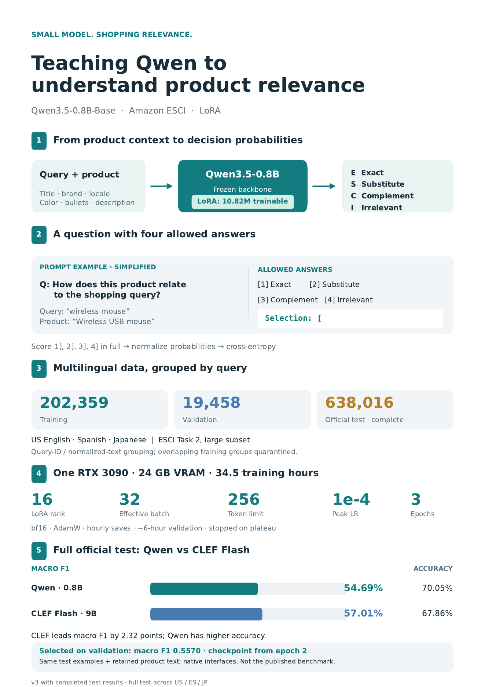

# Small-model shopping relevance with Qwen

An independent experiment fine-tuning **Qwen3.5-0.8B-Base** with LoRA for
Amazon ESCI Task 2: classify a query/product pair as **Exact, Substitute,
Complement, or Irrelevant**, across US English, Spanish, and Japanese.

On all **638,016 official test examples**, the fine-tuned model reached
**54.69% macro F1**, versus **57.01% for CLEF Flash 9B** under matched
product-information inputs. The smaller model trails by 2.32 percentage
points; higher overall accuracy does not imply better balanced classification.

| Model | Macro F1 | Accuracy |
|---|---:|---:|
| Qwen3.5-0.8B + LoRA | 54.69% | 70.05% |
| CLEF Flash 9B | 57.01% | 67.86% |



[One-page PDF](assets/overview.pdf) · [Concise overview](OVERVIEW.md) ·
[Detailed test results](results/comparison.json) · [Experiment record](results/experiment.json)

**Trained adapter:** [Qwen3.5-0.8B-ESCI-LoRA on Hugging Face](https://huggingface.co/tcabanski/Qwen3.5-0.8B-ESCI-LoRA),
with the best checkpoint, model card, and frozen inference example.

## Method and evaluation

The backbone is frozen; **10.82M LoRA parameters** are trained on language-model
linear layers. Each input uses the same fixed instruction, JSON product fields,
four numbered choices, and `Selection: [` prefix. The model scores **all tokens**
in `1]`, `2]`, `3]`, and `4]`; softmax converts the four sequence log scores into
E/S/C/I probabilities. Cross-entropy trains these probabilities. Inference uses
this scoring procedure, rather than generated-answer parsing or a chat template.

Training used **202,359 examples**, with **19,458 validation examples**, on one
RTX 3090 (24 GB). The six-epoch cosine learning-rate schedule stopped after three
epochs and 34.5 training hours when validation plateaued. The selected checkpoint
was saved during epoch 2, with validation macro F1 **0.5570**.

Queries are grouped by connected query IDs and normalized query text across
locales. Training groups touching the official test set are quarantined; the
remaining training groups are split into train/validation before subset sampling.
This prevents those forms of query overlap, but does not detect semantic near
duplicates. Duplicate/conflicting pairs within partitions are retained and audited.

Both comparison models received the same product fields after the Qwen
checkpoint's 256-token field-aware truncation, through their native interfaces.
CLEF used its native joint-schema head. This is **not a reproduction of the
published Decision Index benchmark**, nor an evaluation of CLEF with unrestricted
product context. CLEF's upstream training-data overlap has not been audited here.
Exact matches account for approximately 62% of test examples; macro F1 gives
each class equal weight. Qwen's weaker Substitute and Irrelevant F1 explain most
of its gap. These results do not establish production cost, latency, or robustness.

## Setup

Python 3.11–3.13 and a CUDA GPU supporting bf16 are required for the default
configuration. Tested with Python 3.13 and an RTX 3090.

```bash
export UV_CACHE_DIR="$PWD/.cache/uv"
uv sync --locked --extra dev --extra gpu-kernels
export HF_HOME="$PWD/.cache/huggingface"
export TRITON_CACHE_DIR="$PWD/.cache/triton"
```

## Reproduce the reported experiment

Run preparation once, using the pinned official dataset revision:

```bash
.venv/bin/python -m src.data --download \
  --revision 7916cdf6ab75a462e77f20ab40428a10923998d5 --output data/prepared
.venv/bin/python -m src.subset --source data/prepared --output data/extended
.venv/bin/python -m src.train --config configs/reported.yaml --output runs/qwen
```

Subset selection uses seed 42 and samples 3,000 training and 300 validation
query groups per locale, then includes every row of the selected connected
groups. It produces the reported 202,359 / 19,458 examples. Preparation saves
checksums, split IDs, and leakage audits. Polars preserves the historical row
selection/order; its Parquet byte hashes differ from the original pandas writer.

`configs/reported.yaml` retains the six-epoch scheduler horizon and training
stopping rules, with the expired calendar deadline removed. Validation runs
approximately every six hours of training and at epoch boundaries. Different
hardware and kernels can change validation timing, checkpoint selection, and
scores. The exact historical configuration and environment are preserved in
`results/experiment.json`; bit-for-bit retraining is not promised.

For training on the full prepared training split, use `configs/train.yaml`
(three-epoch schedule). This configuration does **not** describe the reported run.

```bash
# Resume with the identical configuration and dataset.
.venv/bin/python -m src.train --config configs/reported.yaml --output runs/qwen --resume
```

Checkpoints are saved after the first update and hourly. `runs/qwen/last` includes
optimizer, scheduler, RNG, and within-epoch resume state; `runs/qwen/best` stores
the highest validation macro-F1 checkpoint. Scores are in `history.json`.

## Use a trained checkpoint

Model weights are distributed separately on
[Hugging Face](https://huggingface.co/tcabanski/Qwen3.5-0.8B-ESCI-LoRA);
follow its model card to download and use the released adapter. After training, score
synthetic example records with the checkpoint's exact prompt and truncation:

```bash
.venv/bin/python -m src.predict --checkpoint runs/qwen/best \
  --input examples/products.jsonl --output runs/predictions.jsonl
```

Output contains the selected E/S/C/I label and all four probabilities. Input
requires `query` and `product_locale` (`us`, `es`, or `jp`); missing product fields
become empty strings. `--device cpu` uses float32; the default is checkpoint CUDA
settings. These scores should not be treated as calibrated confidence estimates.

To evaluate a frozen checkpoint on the official test split:

```bash
.venv/bin/python -m src.evaluate --checkpoint runs/qwen/best \
  --data data/prepared --split test --output runs/test-metrics.json
```

This performs a complete evaluation without periodic progress saves. The CLEF
comparison code from the historical experiment is excluded from this focused
Qwen training repository; the frozen evaluation protocol, revisions, and aggregate
results are retained in `results/comparison.json`.

## Checks and license

```bash
.venv/bin/ruff check src tests
.venv/bin/pytest -q
```

Tests use tiny offline models; the pinned real-tokenizer test runs only when
its files are already cached. Dataset files, weights, training state, predictions,
and local caches remain excluded from Git.

Code and project artifacts are licensed under [Apache-2.0](LICENSE).
See [NOTICE](NOTICE) for upstream acknowledgments. Downloaded model weights and
data retain their upstream licenses. Sources:
[Qwen](https://huggingface.co/Qwen/Qwen3.5-0.8B-Base),
[Amazon ESCI](https://github.com/amazon-science/esci-data),
[CLEF Flash](https://huggingface.co/Cloudflare/clef-flash).
